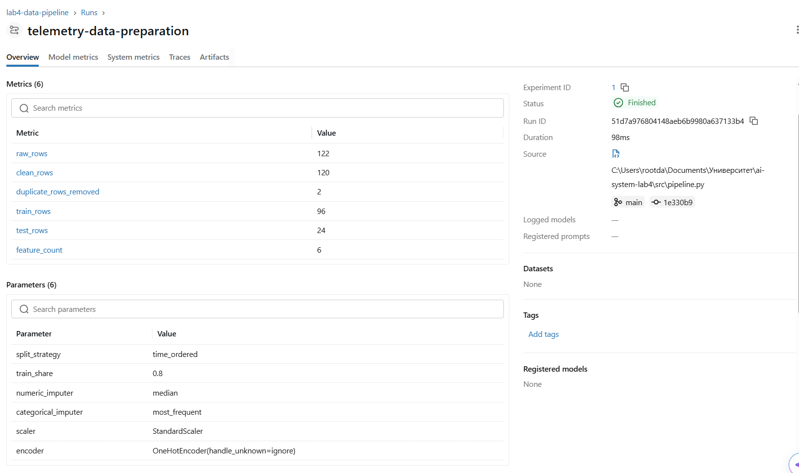

# ЛР4 - Data Pipeline и DataOps для проекта Enterprise RAG

## Структура
- `data/raw/telemetry.csv` - небольшой синтетический исходный набор, 122 строки включая 2 дубликата.
- `src/contracts.py` - контракт Pandera.
- `src/pipeline.py` - валидация, удаление полных дубликатов, временной split, fit только на train, transform на test, Parquet и joblib, MLflow logging.
- `dvc.yaml`, `params.yaml`, `data/raw/telemetry.csv.dvc` - описание и версия входа для DVC.
- `tests/` - позитивный сценарий и проверки ошибочных данных.

## Установка (Python 3.11>= рекомендуется)
```powershell
python -m venv .venv
.venv\Scripts\Activate.ps1
python -m pip install --upgrade pip
python -m pip install -r requirements.txt
```

## Запуск
```powershell
python -m pytest -q
python -m src.pipeline
dvc repro
python -m mlflow ui --backend-store-uri sqlite:///mlflow.db
```
Откройте `http://127.0.0.1:5000`. На Linux/macOS активируйте окружение командой `source .venv/bin/activate`.

## Важные решения
1. Временной split: ранние записи train, поздние test; не используем случайное перемешивание для временных наблюдений.
2. `fit_transform` вызывается только на train. Test обрабатывается исключительно через `transform`.
3. Пропуски в числовых признаках заполняются медианой, категориальный режим - наиболее частым значением; затем StandardScaler и OneHotEncoder.
4. Pandera блокирует недопустимые значения до очистки/преобразования. Ошибки контракта не исправляются молча.
5. В репозитории не должно быть `.venv`, `.env`, `mlruns` и секретов. Синтетический CSV мал и включен для немедленного воспроизведения; DVC pointer предоставлен, при необходимости локальный DVC cache создается командой `dvc add data/raw/telemetry.csv`.

## Ожидаемые результаты
`data/processed/train.parquet`, `data/processed/test.parquet`, `data/processed/validation_report.json`, `artifacts/preprocessor.joblib`. Отчет фиксирует исходное/очищенное число строк, количество дубликатов, размеры split, признаки и SHA-256 исходного CSV.
